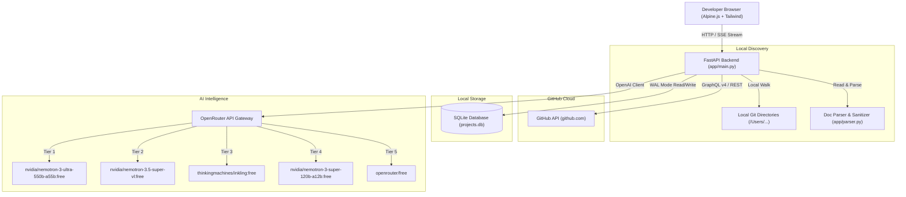

# ARCHITECTURE.md — System Architecture & Component Design

## 1. System Topology & Overview

The **Project Command Center** is a local-first application designed for single-developer portfolio orchestration. It bridges local project folders with GitHub cloud metadata and connects to OpenRouter's free-tier LLM waterfall for strategic enhancement planning.

---

## 2. Component Details

### 2.1 Frontend Layer (`app/static/index.html`)
- **Technology Stack**: Alpine.js v3, Tailwind CSS (CDN), Heroicons, EventSource (SSE).
- **Architecture**: Single Page Application (SPA) without bundler requirements.
- **Views**:
  - **Kanban Board**: Drag-and-drop or select-to-move lifecycle columns with progress bars.
  - **List / Table View**: Sortable metrics table with test status, Docker flags, and completion percentages.
  - **Blockers Radar**: Centralized tracking for unresolved issues across all repositories.
  - **AI Studio**: Cross-portfolio strategy generation (synergies, weekend quick wins, next milestones).
  - **Inspection Drawer**: Detailed inspection of harvested docs, checklists, and single-repo deep-dive AI generation.
- **Real-Time Telemetry**: Live polling (`/api/quota`) and SSE progress updates during sync (`/api/stream/sync`).

### 2.2 API Server (`app/main.py`)
- **Framework**: FastAPI with Uvicorn.
- **Asynchronous Execution**: Asynchronous endpoint handlers with background task runners for sync operations.
- **Endpoints**:
  - `GET /`: Serves static SPA dashboard.
  - `GET /api/projects`: Retrieves all enriched projects and stage classifications.
  - `POST /api/projects/{id}/stage`: Persists manual stage overrides.
  - `POST /api/projects/{id}/ai-toggle`: Enables or disables AI scanning for a given repository.
  - `GET /api/stream/sync`: Server-Sent Events stream for real-time sync progression.
  - `POST /api/sync`: Synchronous sync trigger.
  - `GET /api/quota`: Real-time OpenRouter token and rate-limiting telemetry.
  - `POST /api/ideate/portfolio`: Triggers portfolio-wide strategic analysis.
  - `POST /api/ideate/{repo_id}`: Triggers single-repo deep dive and prompt generation.

### 2.3 Secret Scrubbing & Document Sanitizer (`app/parser.py`)
Before any local markdown or code snippet is stored or transmitted to OpenRouter:
- **Regex Redaction Engine**: Scrubs GitHub tokens (`ghp_`, `gho_`), OpenRouter tokens (`sk-or-v1-`), Gemini keys (`AIza`), generic API keys, private keys, AWS secrets, and database connection strings.
- **Path Stripping**: Replaces absolute user paths with relative paths.
- **Size Capping**: Caps harvested document excerpts to prevent prompt bloat and stay within free-tier context limits.

### 2.4 OpenRouter Multi-Model Waterfall (`app/openrouter_service.py`)
- **Client Protocol**: Standard OpenAI Python SDK configured with `base_url="https://openrouter.ai/api/v1"`.
- **Waterfall Mechanics**: Iterates sequentially through `FREE_TIER_WATERFALL`. If any tier fails with 403, 404, 429, or JSON schema validation errors, the next tier is executed immediately.
- **Reasoning Handling**: Automatically falls back to inspecting `message.reasoning` if the thinking model exhausts tokens before writing to `message.content`.
- **Request Pacing**: Hard-pacing at 1.0s between outgoing calls to prevent bursts on free-tier gateways.

---

## 3. Database Schema (`projects.db`)

SQLite 3 configured with Write-Ahead Logging (`WAL` mode) and `PRAGMA synchronous = NORMAL`.

### Tables
1. **`repositories`**:
   - `id`: INTEGER PRIMARY KEY AUTOINCREMENT
   - `github_id`: TEXT UNIQUE
   - `name`: TEXT
   - `name_with_owner`: TEXT
   - `description`: TEXT
   - `url`: TEXT
   - `is_private`: BOOLEAN
   - `primary_language`: TEXT
   - `languages`: TEXT (JSON array)
   - `stars`: INTEGER
   - `forks`: INTEGER
   - `open_issues_count`: INTEGER
   - `default_branch`: TEXT
   - `detected_stage`: TEXT
   - `stage_override`: TEXT
   - `completion_pct`: REAL
   - `has_tests`: BOOLEAN
   - `has_docker`: BOOLEAN
   - `has_ci`: BOOLEAN
   - `ai_enabled`: BOOLEAN DEFAULT 1
   - `summary_json`: TEXT
   - `updated_at`: TIMESTAMP DEFAULT CURRENT_TIMESTAMP

2. **`action_items`**:
   - `id`: INTEGER PRIMARY KEY AUTOINCREMENT
   - `repo_id`: INTEGER REFERENCES repositories(id)
   - `source_file`: TEXT
   - `title`: TEXT
   - `is_completed`: BOOLEAN DEFAULT 0
   - `is_blocker`: BOOLEAN DEFAULT 0
   - `created_at`: TIMESTAMP DEFAULT CURRENT_TIMESTAMP

3. **`ai_enhancements`**:
   - `id`: INTEGER PRIMARY KEY AUTOINCREMENT
   - `repo_id`: INTEGER REFERENCES repositories(id)
   - `category`: TEXT ('quick_win', 'next_stage', 'synergy')
   - `title`: TEXT
   - `rationale`: TEXT
   - `antigravity_prompt`: TEXT
   - `status`: TEXT DEFAULT 'suggested'
   - `created_at`: TIMESTAMP DEFAULT CURRENT_TIMESTAMP

4. **`api_quota_log`**:
   - `id`: INTEGER PRIMARY KEY AUTOINCREMENT
   - `model_name`: TEXT
   - `operation_type`: TEXT
   - `prompt_tokens`: INTEGER
   - `candidates_tokens`: INTEGER
   - `status`: TEXT
   - `timestamp`: TIMESTAMP DEFAULT CURRENT_TIMESTAMP
